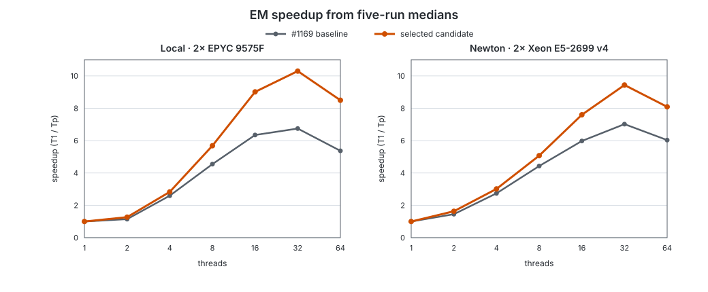
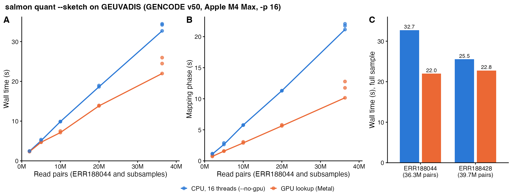

# The EM/VBEM phase: deterministic thread-scaling optimization

This is the implementation and measurement record for the deterministic EM
thread-scaling work stacked on #1169. It describes the final layout, the
floating-point-order constraints, the candidates that were retained or
rejected, and the exact two-host benchmark protocol used for the decision.

The work started at `74ef60f6`, the head of #1169 (which itself depends on
#1167). After #1169 merged, it was rebased without content changes onto the
resulting `develop` merge commit `adbbaee6`, as required. Exact pre-rebase
measurement and final review commit ids are:

| stage | measured id | final rebased id |
|---|---|---|
| benchmark harness | `4c8b0a98` | `f45ec7a2` |
| compressed incidence-balanced shards | `53e46fb7` | `dfbeb1f9` |
| deterministic vector/bootstrap work | `1c0bd08c` | `61d8ff05` |
| complete equivalence-class ordering | `0f9bc742` | `2477cd28` |
| selected 128-shard cap | `04c0a93b` | `27c19a71` |
| posterior timing in harness | `b24dbb9d` | `9191b4f1` |

---

## 1. Why this phase matters

On a 26.1M-fragment sketch run against GENCODE v49 (238,442 transcripts), the
wall time splits roughly:

| phase | time | share |
|---|---|---|
| phase 1 — mapping (includes writing the intermediate RAD) | 30.5 s | 45% |
| phase 2 — **EM inference** | 31.9 s → **15.2 s after #1167** | 47% → ~31% |
| phase 2 — RAD read | 3.9 s | 6% |
| index load, eff-length collapse, posterior, output | ~1.5 s | 2% |

Before #1167 the EM was as expensive as all of mapping. It is now roughly half
that, and it is still the second-largest cost and the one that scales worst.

Measured on `newton` (2× Xeon E5-2699 v4, 44 physical cores/88 hardware
threads); see §7 for the data.

---

## 2. Where the EM sits

Two entry points, both in `crates/salmon-infer/src/lib.rs`:

- `optimize(...)` — builds a `PackedEqClasses` from a `CollapsedEqClasses` and
  runs to convergence.
- `optimize_packed_with_init(p, opts, parallel, init_alphas, eff_lens)` — the
  one production actually calls, with `parallel = true` everywhere (reads mode
  `salmon-quant/src/lib.rs:1039,1041,1249`; RAD/alignment
  `salmon-align/src/rad.rs:2214,2216,2294` and `salmon-align/src/lib.rs:2461,2463,2500`).

Both funnel into **`run_em_counts(p, counts, opts, parallel, min_iter, init_alphas, eff_lens)`**
(`lib.rs:279`), which owns the buffers, builds the shard plan, selects the
M-step kernel, and drives one of three convergence loops.

These two arguments used to be a live footgun: `init_alphas` precedes
`eff_lens`, both were `Option<&[f64]>`, and swapping them type-checked
silently. It shipped that way once — the bootstrap path passed effective
lengths into the `init_alphas` slot, which left `--perNucleotidePrior` inert
inside every replicate *and* warm-started each replicate from the
effective-length vector, so the reported spread was drawn under a different
prior than the point estimate it quantified.

**That is now a compile error.** They are distinct newtypes,
`InitAlphas<'a>` and `EffLens<'a>`, each wrapping `Option<&'a [f64]>`:

```rust
run_em_counts(p, counts, opts, parallel, min_iter,
              InitAlphas::NONE,            // or InitAlphas::new(&warm)
              EffLens::new(&eff_lengths))  // or EffLens::NONE
```

Three properties are worth preserving if you touch them:

- **Zero overhead is asserted, not assumed** — a `const _: () = assert!(...)`
  in `lib.rs` checks that both newtypes have the same layout as
  `Option<&[f64]>` (16 bytes). If a future change makes them fatter, the crate
  stops compiling.
- **The swap is proven impossible** by a `compile_fail` doctest on
  `InitAlphas`, which runs under `cargo test --doc` and doubles as API
  documentation. Weakening the types breaks that test.
- **No `Deref`, no `Into<Option<..>>`** — deliberately. An implicit conversion
  back to the bare type would reopen the hole. The accessor is `pub(crate)`.

### Callers with different needs

- **Point estimate** — `parallel = true`, full iteration budget.
- **Bias seed EM** (`salmon-quant/src/lib.rs:1039`) — a deliberately
  under-converged short run (`min_iter = max_iter = bias_seed_em_iters`,
  `min_alpha = 0.0`) whose output seeds the bias model.
- **Bootstrap replicates** (`uncertainty.rs:136`) — `parallel = false`, because
  the *replicates* are the parallel dimension; each replicate runs a sequential
  EM inside a `par_iter` over replicates. Optimizing the sequential kernel
  therefore matters as much as the parallel one for `--numBootstraps` runs.
- **Gibbs** (`uncertainty.rs`) — separate sampler, shares `PackedEqClasses`
  and the `weights` array rather than `combined`.

---

## 3. The data structure: `PackedEqClasses` (CSR)

`crates/salmon-infer/src/packed.rs`. Flat CSR, built once per run:

```
labels:   Vec<u32>   flat transcript ids; class i spans labels[starts[i]..starts[i+1]]
starts:   Vec<u64>   CSR offsets, len = num_classes + 1
combined: Vec<f64>   weight/effLen per (class, transcript) incidence — EM reads this
weights:  Vec<f64>   raw conditional weights, same layout — Gibbs reads this
counts:   Vec<u64>   per-class fragment count
num_txps: usize
```

`starts` is `u64` deliberately: these are cumulative *incidence* counts, and a
`u32` wrapped silently past 4G incidences and handed the optimizer slices
belonging to other classes (#1097). Costs ~3.5% of the structure.

Scale on the reference dataset: **536,311 classes, 238,442 transcripts**, mean
class size 12.9, and **6,933,617 incidences**. Each M-step reads every incidence
twice (denominator, then distribution) — about 13.9M f64 reads of `combined` plus
the same number of scattered reads of `alpha_in` and scattered writes to an
accumulator.

`weights` is populated only when a posterior method needs it
(`PosteriorMethod::needs_raw_weights`); a point-estimate run does not pay for
it.

---

## 4. The M-step kernels

Four, dispatched by `(use_vbem, parallel)` in the closure at `lib.rs:~300`:

| | sequential | parallel |
|---|---|---|
| EM | `em_step_seq` | `em_step_par` |
| VBEM | `vbem_step_seq` | `vbem_step_par` |

**Plain EM**, per class `ci` with `count` fragments and members `(tid, w)`:

```
denom = Σ alpha_in[tid] * w
if denom > MIN_EQ_CLASS_WEIGHT:
    inv = count / denom
    for each (tid, w): acc[tid] += alpha_in[tid] * w * inv
```

Single-member classes short-circuit to `acc[tid] += count`. The inner product
is recomputed rather than cached in scratch — the multiply was measured cheaper
than the extra memory traffic inside the parallel closure.

**VBEM** substitutes `exp_theta` for `alpha`:
`exp_theta[i] = exp(digamma(alpha_i + prior_i) − digamma(Σ_j alpha_j + prior_j))`,
computed by `fill_exp_theta` once per M-step. The point-estimate execution mode
keeps the global sum in its historical sequential order, then evaluates the
independent `digamma`/`exp` map in parallel. Bootstrap replicates use a wholly
sequential execution mode because the replicate iterator is already the
parallel dimension. A fixed-chunk parallel sum was measured and rejected; see
§8.

Priors come from `prior_alphas_vec` (`lib.rs:241`): flat `vb_prior` per
transcript, or `vb_prior * max(1, effLen)` under `--perNucleotidePrior`.

**VBEM is the production default** (`opt_type: "vb"`; the CLI sets
`use_vbem = !args.use_em && !args.meta`). `EmOptions::default()` has
`use_vbem: false`, so any benchmark or test built on the default is exercising
the *non*-default kernel. This mattered: the original determinism test did
exactly that.

---

## 5. Parallelism: the compressed `ShardPlan`

### What it was

```rust
let nshards = rayon::current_num_threads().clamp(1, 64);
// per shard, per iteration:
buf.iter_mut().for_each(|x| *x = 0.0);      // dense clear,  O(num_txps)
...
reduce_shards(shards, alpha_out);            // dense reduce, O(nshards * num_txps)
```

Each shard owned a private dense `num_txps` accumulator and processed a
contiguous slice of classes with non-atomic adds — chosen over a shared
`AtomicF64` array, which contended badly on hot transcripts.

**Two defects.**

1. **Determinism.** `nshards` tracked the thread count, so `-p` changed the
   class partition and therefore the grouping of floating-point sums. On real
   data `-p 4` and `-p 32` produced different `quant.sf`, *at default
   precision*. Confirmed by construction: `-p 64` and `-p 80` (both clamped to
   64) were byte-identical; `-p 16` differed.
2. **Scaling.** Clear + reduce cost `O(nshards × num_txps)` per iteration
   regardless of the data — ~30M ops at 64 shards against 6.9M incidences of
   real work — and grew with thread count while the work stayed fixed.

### Final layout

`ShardPlan` (`packed.rs`) is now built once from the packed data and contains:

- `boundaries: Vec<usize>` — contiguous class ranges chosen at equal
  cumulative-incidence targets. A class is never split.
- `local_lens: Vec<usize>` — the exact compressed accumulator length for each
  shard.
- `entry_local: Vec<u32>` — one local accumulator index aligned with every
  packed incidence. The repeated M-step therefore performs a direct indexed
  add, with no binary search or hash lookup.
- `contrib_start: Vec<u64>` and contributor records `(u16 shard, u32 local)` —
  the transcript-to-shard CSR used by reduction. The `u64` offsets and checked
  conversions preserve the packed layout's support beyond 4G incidences.

Sorted, deduplicated touched-transcript vectors exist only while the plan is
constructed. They build `entry_local` and the contributor CSR, then are
dropped. Each iteration clears each compressed accumulator contiguously,
accumulates classes in class order, and reduces each transcript through its
contributors in ascending shard order.

The selected constants are:

```rust
MAX_SHARDS = 128
MIN_INCIDENCES_PER_SHARD = 4096
```

The shard count is
`ceil(total_incidences / 4096).clamp(1, min(128, num_classes))`. Neither it nor
the boundaries inspect the Rayon pool or `-p`; Rayon only schedules the fixed
logical shards. Per-iteration buffer clear and reduction work is
`O(Σ|touched|)`, on the order of incidence count, instead of
`O(nshards × num_txps)`.

On the measured RAD, the 128 compressed accumulators contain 368,110 `f64`
slots in total: 2.81 MiB versus 116.43 MiB for #1169's 64 dense buffers. The
retained local-index and contributor structures bring the complete final plan
plus buffers to about 33.9 MiB (`entry_local` alone is 26.45 MiB for 6,933,617
incidences). Construction-only touched vectors are not retained.

There is one upstream ordering requirement: range-factorized equivalence
classes are sorted by the complete `(txps, bins)` identity. Sorting only by
`txps` left ties in `DashMap` iteration order, which changed otherwise-fixed
shard groupings. Commit `2477cd28` fixes that latent source of
cross-thread-count nondeterminism.

### Determinism invariants (do not break these)

Any future change must preserve all five, or `quant.sf` stops being
reproducible across `-p`:

1. The packed class order is deterministic over the complete class identity.
2. Shard count and boundaries depend only on the data.
3. Each shard's accumulation order over its classes is fixed.
4. The reduction sums a transcript's contributors in a fixed (ascending shard)
   order.
5. Any parallel vector reduction uses a data-fixed partition and fixed final
   order, never a pool-dependent fold/reduce.

Structural tests prove that ranges cover every class exactly once, compressed
indices map back to the correct transcript, contributor lists are ascending,
and empty and skewed inputs are valid. Test-only dense reference kernels use
the same boundaries and must match compressed one-step EM and VBEM bit for
bit. Full `EmResult` values are compared bit for bit across explicit Rayon
pools of 1/2/3/8/16 threads for plain EM and VBEM with `None`, SQUAREM, and
DAAREM acceleration, plus per-nucleotide VBEM. A RAD integration test provides
the end-to-end thread-count invariant.

---

## 6. Convergence and acceleration

### The loop

`max_rel_diff(alpha_in, alpha_out, cutoff)` (`lib.rs:~250`) — max over
transcripts of `|out−in|/out`, considering only transcripts with
`alpha_in > alpha_check_cutoff` (without the cutoff a transcript oscillating
between 1e-30 and 2e-30 blocks convergence forever). The parallel path divides
the vectors into fixed 2,048-element chunks, computes one maximum per chunk,
and combines those maxima in ascending chunk order. Its scratch vector is
allocated once and reused. The exact sequential qualification semantics are
preserved: zero denominators do not qualify, NaNs never replace a current
maximum, and no qualifying transcript returns negative infinity.

Buffers are swapped, not copied. `min_iter` floors the convergence check;
`max_iter` is the hard stop.

### Acceleration (`EmAccel`)

- **`None`** (default) — plain fixed-point iteration, one M-step per iteration.
  Output unchanged from historical salmon.
- **`Squarem`** (SqS3) — per cycle: two M-steps `x1=F(x0)`, `x2=F(x1)`, form
  `r = x1−x0` and `v = (x2−x1)−r`, extrapolate
  `xp = x0 − 2αr + α²v` with `α = −‖r‖/‖v‖` clamped to `α ≤ −1`, halving back
  toward −1 if any component goes negative; then a stabilizing third M-step
  `x_next = F(xp)`. Three M-steps per cycle, far fewer cycles. Not
  byte-identical to `None` (different iterate sequence, same fixpoint within
  `rel_diff_tol`).
- **`Daarem`** — damped Anderson acceleration with restarts and
  residual-monotonicity control over a window of recent iterates
  (`daarem.rs`, 539 lines). Better than SQUAREM on ill-conditioned,
  high-dimensional problems.

SQUAREM and DAAREM inherit the parallel fixed-chunk convergence maximum. Their
norm and dot-product arithmetic remains sequential over `num_txps`
deliberately; restructuring those reductions is follow-up scope so this change
does not alter their floating-point trajectories.

### Finalization

`finalize_truncate_redistribute` (`lib.rs:~265`) — applies `min_alpha`
truncation as a *mass-preserving redistribution* (a masked final M-step over
the surviving members), not a rescale. Mass that cannot be redistributed
(fully-truncated classes) is reported as `inference_truncated_mass`. A
non-positive `min_alpha` makes it a no-op (used by the bias warm-up).

---

## 7. What has been done, with measurements

| change | effect | where |
|---|---|---|
| CSR `PackedEqClasses` replacing per-class `Vec`s | (pre-existing) | `packed.rs` |
| Per-shard dense accumulators replacing a shared `AtomicF64` array | removed CAS contention on hot transcripts | `packed.rs` |
| `u64` CSR offsets | correctness past 4G incidences (#1097) | `packed.rs` |
| SQUAREM, DAAREM | opt-in, far fewer M-steps | `lib.rs`, `daarem.rs` |
| `InitAlphas` / `EffLens` newtypes | made the argument-swap bug a compile error | `lib.rs` |
| **Data-derived shard count** (#1167) | **fixed cross-`-p` reproducibility** | `packed.rs` |
| **Sparse clear via `touched`** (#1167) | see below | `packed.rs` |
| **Parallel sparse reduce via CSR inversion** (#1167) | see below | `packed.rs` |
| **Compressed shard buffers + direct local indices** (`dfbeb1f9`) | removes dense accumulator working set and hot-loop lookup | `packed.rs` |
| **Incidence-balanced, fixed 128-shard cap** (`27c19a71`) | reduces class-size tail imbalance | `packed.rs` |
| **Fixed-chunk convergence maximum** (`61d8ff05`) | removes a per-iteration serial vector pass | `lib.rs`, `daarem.rs` |
| **Parallel point-estimate VBEM map / sequential replicate mode** (`61d8ff05`) | speeds production VBEM without nested Rayon | `packed.rs` |
| **Complete range-factorized class ordering** (`2477cd28`) | removes `DashMap` tie-order nondeterminism | `salmon-eqclass` |

EM phase time, newton, same binary pair, back to back, sketch, 26.1M fragments:

| `-p` | before #1167 | after #1167 | |
|---|---|---|---|
| 16 | 32.58 s | **15.19 s** | 2.14× |
| 32 | 23.69 s | **13.95 s** | 1.70× |

Mapping and RAD-read unchanged, so the effect is isolated to this phase.

End-to-end wall on an EPYC 9575F (10M-pair equivalent workload, sketch):
`-p 4` 1.03×, `-p 16` 1.06×, `-p 32` 1.14×, `-p 64` 1.17×.

### Selected build: five-repetition RAD A/B

Values are median ± MAD. RSS is MiB; speedup is `T1/Tp` from the same arm and
efficiency is speedup divided by thread count. Complete per-run data are in
[`benchmarks/em-thread-scaling/`](benchmarks/em-thread-scaling/).

Local, dual-socket EPYC 9575F:

| `-p` | EM baseline (s) | EM candidate (s) | wall baseline (s) | wall candidate (s) | RSS baseline | RSS candidate | speedup B / C | efficiency B / C |
|---:|---:|---:|---:|---:|---:|---:|---:|---:|
| 1 | 51.271±0.052 | 50.325±0.044 | 69.85±0.03 | 68.98±0.07 | 669.0±9.7 | 642.2±8.6 | 1.000 / 1.000 | 100.0% / 100.0% |
| 2 | 44.643±1.908 | 39.752±4.598 | 52.73±0.96 | 48.95±4.39 | 670.9±7.5 | 673.5±18.8 | 1.148 / 1.266 | 57.4% / 63.3% |
| 4 | 19.765±0.412 | 17.786±1.039 | 23.58±0.22 | 22.06±0.61 | 751.5±21.9 | 727.0±3.0 | 2.594 / 2.829 | 64.9% / 70.7% |
| 8 | 11.274±0.277 | 8.853±0.317 | 14.34±0.31 | 11.96±0.80 | 849.4±2.3 | 880.1±20.4 | 4.548 / 5.685 | 56.8% / 71.1% |
| 16 | 8.076±0.259 | 5.583±0.164 | 9.84±0.34 | 7.32±0.10 | 1069.8±13.1 | 1058.6±9.0 | 6.349 / 9.013 | 39.7% / 56.3% |
| 32 | 7.602±0.218 | 4.886±0.170 | 9.10±0.21 | 6.42±0.19 | 1114.1±4.2 | 1110.0±3.9 | 6.745 / 10.300 | 21.1% / 32.2% |
| 64 | 9.547±0.150 | 5.921±0.149 | 11.09±0.31 | 7.42±0.08 | 1398.5±22.1 | 1422.6±12.3 | 5.371 / 8.499 | 8.4% / 13.3% |

Newton, dual-socket Xeon E5-2699 v4:

| `-p` | EM baseline (s) | EM candidate (s) | wall baseline (s) | wall candidate (s) | RSS baseline | RSS candidate | speedup B / C | efficiency B / C |
|---:|---:|---:|---:|---:|---:|---:|---:|---:|
| 1 | 94.517±0.196 | 94.029±0.178 | 129.59±0.18 | 128.90±0.17 | 653.5±7.1 | 610.0±4.9 | 1.000 / 1.000 | 100.0% / 100.0% |
| 2 | 64.989±0.577 | 57.576±0.229 | 82.93±0.70 | 74.69±1.43 | 665.4±2.9 | 662.5±21.8 | 1.454 / 1.633 | 72.7% / 81.7% |
| 4 | 34.463±0.225 | 31.174±0.018 | 41.92±0.18 | 38.43±0.19 | 702.6±4.7 | 715.1±5.0 | 2.743 / 3.016 | 68.6% / 75.4% |
| 8 | 21.337±0.146 | 18.547±0.012 | 25.70±0.10 | 22.99±0.05 | 818.1±3.0 | 806.1±6.4 | 4.430 / 5.070 | 55.4% / 63.4% |
| 16 | 15.811±0.063 | 12.374±0.029 | 20.03±0.06 | 16.72±0.07 | 1031.0±12.6 | 911.7±20.5 | 5.978 / 7.599 | 37.4% / 47.5% |
| 32 | 13.464±0.006 | 9.963±0.053 | 17.68±0.11 | 14.24±0.03 | 1128.8±18.6 | 1009.5±10.9 | 7.020 / 9.438 | 21.9% / 29.5% |
| 64 | 15.666±0.216 | 11.621±0.315 | 20.10±0.26 | 16.00±0.32 | 1331.6±30.6 | 1342.9±7.4 | 6.033 / 8.091 | 9.4% / 12.6% |

The 16/32/64-thread EM geometric mean fell from 8.369 to 5.446 s locally
(**34.9%**) and from 14.940 to 11.273 s on newton (**24.5%**). The 16→32
scaling ratio improved from 1.062 to 1.143 locally and from 1.174 to 1.242 on
newton. At the protected low-thread points, candidate EM time improved by 1.8%
and 10.0% locally and by 0.5% and 9.5% on newton at 1 and 4 threads,
respectively.

The candidate produced exactly one `quant.sf` hash across every thread count on
each host: `2a86764f...f6860a3` locally and `6cc0241a...7a8710` on newton. All
70 candidate runs converged in 2811 iterations. Against the corresponding
baseline one-thread output, normalized L1 count difference was
`4.7980e-16` local / `3.7317e-16` newton and maximum symmetric relative
difference above the 0.01-count convergence cutoff was `1.1440e-10` /
`2.2518e-11`. Every count was finite and nonnegative; total mass was conserved
at 18,760,450 fragments. No fallback to #1169's class-balanced boundaries was
needed.

The baseline produced one stable hash per thread count rather than one per
host. That exposed the range-factorized `(txps, bins)` tie-order defect fixed
by `2477cd28`; the candidate end-to-end determinism result therefore validates
both the fixed plan arithmetic and its packed-input ordering.

One process-wide generic `perf stat` run per high-thread point produced the
following counters. Values are baseline / candidate in billions; the isolated
EM-time change from that same run is included. These are aggregate counters
across all workers and all RAD-quantification phases, so a candidate can spend
more total cycles while completing sooner by keeping more cores useful.

| host | `-p` | EM change | cycles (G) | instructions (G) | cache misses (G) |
|---|---:|---:|---:|---:|---:|
| local | 16 | -34.1% | 417.9 / 416.6 | 1145.0 / 1133.5 | 1.350 / 0.921 |
| local | 32 | -35.2% | 663.4 / 662.9 | 1186.4 / 1162.0 | 2.397 / 1.897 |
| local | 64 | -42.5% | 1786.1 / 1599.1 | 1317.8 / 1268.7 | 7.344 / 6.200 |
| newton | 16 | -22.5% | 569.1 / 571.3 | 1072.2 / 1054.1 | 3.790 / 4.933 |
| newton | 32 | -24.5% | 764.7 / 833.6 | 1131.4 / 1114.0 | 3.963 / 4.903 |
| newton | 64 | -24.5% | 1698.5 / 1915.2 | 1295.4 / 1291.0 | 4.291 / 4.607 |



---

## 8. Selection gates, rejected candidates, and follow-up scope

Four fixed configurations were built from the same production changes and
timed at 16/32/64 threads on both hosts. Each cell below is the geometric mean
of the three median EM times; the final column combines the two host values.

| partition | local EPYC | newton | combined | vs best |
|---|---:|---:|---:|---:|
| compressed 64, class-balanced | 5.762 s | 13.121 s | 8.695 s | +12.72% |
| compressed 64, incidence-balanced | 5.751 s | 12.200 s | 8.376 s | +8.59% |
| compressed 128, incidence-balanced | 5.375 s | 11.207 s | 7.761 s | +0.61% |
| compressed 256, incidence-balanced | 5.412 s | 10.994 s | **7.714 s** | best |

The 128- and 256-shard configurations differ by only 0.61%, below the
pre-declared 2% tie threshold, so the lower 128-shard cap is selected. The
minimum 4,096 incidences per shard remains in every configuration. These are
data constants, not adaptive tuning based on the available pool.

Other decisions:

- A fixed-chunk parallel reduction for VBEM's global alpha/prior sum was
  rejected. It improved neither the incremental kernel nor the required 3%
  gate and regressed the 16-thread kernel by about 5.1%. The historical
  sequential sum stays; only the point-estimate element map is parallel.
- Fully sequential work inside each bootstrap replicate was retained. With 32
  replicates, median posterior time fell from 123.50 to 99.06 s at 16 threads
  (19.8%) and from 55.87 to 52.87 s at 32 threads (5.4%). The sequential
  50-step VBEM kernel improved about 25%. This gate used production commit
  `2477cd28` (measured before the rebase as `0f9bc742`); the later 128-vs-256
  change affects only the parallel shard plan,
  which a sequential bootstrap replicate never constructs, so the posterior
  code executed is identical to the selected build.
- A shared atomic accumulator remains rejected: CAS contention on hot
  transcripts dominated. Caching `alpha_in[tid] * w` in per-class scratch also
  remains rejected because its extra memory traffic cost more than the
  recomputed multiply.
- Shard count or boundaries must never track threads; that changes arithmetic
  grouping and violates the primary contract.

The next plausible target is the still-sequential SQUAREM/DAAREM norm and dot
work. It needs an independently measured, data-fixed reduction design and is
intentionally left for a follow-up. A single exceptionally large equivalence
class also remains indivisible; addressing that would change within-class
summation and therefore needs a separate determinism design.

---

## 9. Test data, hosts, and reproduction protocol

**Dataset**: SRR21186103, human, paired-end 2×~100 bp, **26,135,185 fragments**,
71.8% mapping rate against GENCODE v49. The source reads are
`/scratch1/rob/rshash_testing/human_reads/SRR21186103_{1,2}.fastq.gz` locally
and `/mnt/scratch7/rob_disktest/data/` on newton. The indexes are respectively
`/scratch1/rob/flex_bench/salmon_idx/gencode_v49` and the `gencode_v49`
directory beside newton's reads.

The reusable RAD contains 18,760,450 mapped fragments and produces **536,311
equivalence classes**, **6,933,617 incidences**, 238,442 transcripts, and **2811
VBEM iterations** to convergence.

| host | processors used | memory | RAD path | RAD SHA-256 |
|---|---|---:|---|---|
| local | 2× AMD EPYC 9575F, 64 physical cores/socket, SMT2 | 1.5 TiB | `target/em-scaling/local-workload.rad` | `fe481b65ed77fd6caaead6e3a335ba2231fa5602d878e2504e327e76619cc881` |
| newton | 2× Intel Xeon E5-2699 v4, 22 physical cores/socket, SMT2 | 504 GiB | `/mnt/scratch7/rob_disktest/em-thread-scaling/workload.rad` | `68fc76dcb12500cfd3e1e6c295f8c9912d6a3d055a3d1f0dc3aae9664ab4fcc4` |

Baseline was measured at `4c8b0a98` (final equivalent `f45ec7a2`; benchmark-only
changes over #1169), binary SHA-256
`8403ea67f0a0ac2357a7febe5e7eff2c577dec98806ffab0464b8db6211a5f65`.
Candidate production was measured at `04c0a93b` (final equivalent `27c19a71`),
binary SHA-256
`ee24a92ac239392e554e10d8ce658eecdc49f14ff1e72d8c8d0eabe650e4b802`.
Those binary hashes are identical on the two hosts because the same release
artifacts were copied to newton.

### Reproducing the measurement

Create one RAD per host, then reuse it for every arm. The local command was:

```bash
target/release/salmon quant \
  -i /scratch1/rob/flex_bench/salmon_idx/gencode_v49 -l A \
  -1 /scratch1/rob/rshash_testing/human_reads/SRR21186103_1.fastq.gz \
  -2 /scratch1/rob/rshash_testing/human_reads/SRR21186103_2.fastq.gz \
  -p 64 --sketch --writeRad target/em-scaling/local-workload.rad \
  -o target/em-scaling/local-rad-build
```

`scripts/bench_em_rad.sh` performs an unrecorded warmup for both binaries,
uses explicit `1,2,4,8,16,32,64` thread counts, and alternates arm order for
five repetitions. It records `em_bias`, `posterior`, RAD-read and wall time,
user/system CPU time, peak RSS, iteration/convergence metadata, and the
`quant.sf` SHA-256.

```bash
scripts/bench_em_rad.sh \
  --baseline target/em-scaling/bin/salmon-4c8b0a98 \
  --candidate target/em-scaling/bin/salmon-04c0a93b \
  --rad target/em-scaling/local-workload.rad \
  --out target/em-scaling/local-ab-04c0a93b \
  --cpu-order 0,64,1,65,2,66,3,67,4,68,5,69,6,70,7,71,8,72,9,73,10,74,11,75,12,76,13,77,14,78,15,79,16,80,17,81,18,82,19,83,20,84,21,85,22,86,23,87,24,88,25,89,26,90,27,91,28,92,29,93,30,94,31,95
```

Newton uses physical cores from both sockets first
(`0,22,1,23,...,21,43`), followed by SMT siblings for 64-thread runs
(`44,66,45,67,...,53,75`). Generic counters were collected separately with:

```bash
perf stat -x $'\t' -e cycles,instructions,cache-misses -- \
  taskset -c "$AFFINITY" "$BINARY" quant --rad "$RAD" -l A \
  -p "$THREADS" --sigDigits 9 -o "$OUT"
```

On a RAD-only invocation, the timed phases are `rad_read`, `em_bias`,
`posterior`, and `output`; the harness extracts the last occurrence of each
named phase after stripping ANSI escapes.

Kernel/loop selection (verified against `salmon quant --help`):

| flag | effect |
|---|---|
| *(none)* | VBEM — **the production default** |
| `--useEM` | plain EM kernel |
| `--meta` | plain EM + no range factorization (overrides `--useEM`) |
| `--emAccel none\|squarem\|daarem` | convergence loop; `none` is the default |
| `--perNucleotidePrior` | VBEM prior becomes `vb_prior * effLen` |
| `--numBootstraps N` | N sequential EMs inside a parallel iterator (exercises `em_step_seq`) |

Benchmark VBEM unless you specifically mean to measure plain EM — the default
`EmOptions` says otherwise and it is an easy mistake.

### Benchmarking caveats learned the hard way

- **Warm the page cache first.** With 503 GB of RAM, the first run over this
  1.7 GB of input is materially slower than later ones. An early A/B here
  showed a "19% penalty" that was entirely cold-cache input reads attributed to
  whichever arm ran first. Run once to warm, then measure.
- **Do not interleave arms with other work.** Wall-time comparisons taken from
  a script that ran other binaries between arms disagreed with back-to-back
  phase measurements by ~20 points.
- **The online path had enormous variance at high `-p`.** Four repeats at
  `-p 64` gave 103.6, 59.8, 104.5, 55.5 s — bimodal, an 88% spread — while the
  deterministic path held 39–42 s. Any single-run comparison against `--online`
  (removed in 2.12.0; use a ≤2.11 binary) at high thread counts is meaningless.
- **`salmon --version` on a fresh binary first.** newton is Broadwell with no
  AVX-512; the build config floors at `x86-64-v2` with runtime SIMD dispatch,
  so binaries built on the AVX-512 submit host do run — but a
  `target-cpu=native` build would `SIGILL` there.
- No root on newton, so caches cannot be dropped between runs.

### A smaller local fixture

For quick iteration without newton, the determinism test's synthetic generator
(`packed.rs::shard_plan_determinism`) builds 20,000 classes over 5,000
transcripts with non-representable weights — enough to shard several times and
to expose grouping differences, and it runs in under a second.

---

## 10. Experimental GPU warm start (on by default; `--no-gpu`)

A GPU path for the point estimate. The standard `salmon-cli` build carries
two backends as default features: Metal on macOS (Apple GPUs) and ROCm on
Linux (AMD GPUs: the same kernels in HIP C++, compiled at run time with
hiprtc). A third, `--features cuda`, is written with NVIDIA's
[CUDA Rust](https://github.com/NVIDIA/cuda-rust) Tile track (cuTile 0.5) and
stays opt-in because it needs the CUDA headers to build.

`quant` uses the GPU automatically when all of these hold:

- the build has a backend for this platform;
- that backend finds a device;
- the CPU would iterate at least 250,000 class–transcript incidences as a
  whole (see below);
- `--no-gpu` is not given.

Otherwise the run is CPU-only and §5 holds unchanged. A CPU-only build is
`cargo build -p salmon-cli --no-default-features`. Library callers keep
`EmOptions::gpu = false` unless they set it.

The floor counts the work the GPU would take over, not the problem size. The
default (unaccelerated) CPU engine works by connected component: each
component runs until it converges on its own, and components under 65,536
incidences run side by side. Only larger ones are stepped one at a time, in
parallel. The GPU iterates every transcript until the slowest one converges:
600–1,000 M-steps, about 0.1 s even on a small problem. It therefore only pays
off on those large components, and the floor counts their incidences
(`ComponentPlan::large_incidences`). With SQUAREM or DAAREM, which iterate the
whole vector, it counts every incidence. The ignored test
`gpu::tests::crossover` times these layouts on the machine below (default
VBEM, best of 3, classes drawn within "genes", a quarter single-transcript).
The GPU column was measured with the warm start always on, before this rule:

| classes drawn within | incidences | CPU only | GPU warm start, always |
|---|---:|---:|---:|
| 40-transcript genes (as in a transcriptome) | 2.1M | 0.17 s | 0.28 s |
| components of ~18k incidences | 0.59M | 0.06 s | 0.11 s |
| components of ~49k incidences | 2.3M | 0.25 s | 0.29 s |
| components of ~73k incidences | 2.3M | 0.51 s | 0.24 s |
| one component | 0.59M | 0.20 s | 0.08 s |
| one component | 2.3M | 0.63 s | 0.23 s |

The first three rows now stay on the CPU. Before this rule the floor was 250,000
incidences in all, which sent the 363k-incidence problem of the `--sketch` runs
below (69,116 components, none large) to the GPU: 0.10–0.12 s there against
0.04–0.05 s on the CPU.

Because the GPU is used by default, the same command can give slightly
different counts on a machine with a supported GPU and on one without.
The two agree to the convergence tolerance, as described below. Use `--no-gpu`
for bit-for-bit reproducibility across machines. In `meta_info.json`,
`gpu_backend` names the backend that ran, or is `null` for a CPU-only run.

### What it does

The GPU does not replace the optimizer. `run_em_counts` hands the start
vector to `gpu::converge`, which runs the same fixed-point iteration in `f32`
until the global `max_rel_diff` criterion holds. The unchanged CPU engine
(component engine, SQUAREM or DAAREM) then continues from that vector in `f64`
under its own stopping rule. Its `min_iter` floor is reduced by the GPU steps
already taken, so a converged warm start usually needs only a few CPU steps.
The GPU is skipped for bootstrap replicates (`parallel = false`) and for the
fixed-length bias-seed runs (`min_iter == max_iter`). With no device, a kernel
compile failure or more than 2³¹ incidences, it logs a warning and the CPU
runs exactly as with `--no-gpu`. A machine with no device is not a failure:
the CPU runs, with only a debug-level log line.

Layout (`gpu::Problem`): single-transcript classes are folded into a constant
per transcript, the rest stay in packed order as a CSR plus its transpose
(transcript → classes, ascending). Both CSRs are cut into chunks of at most
32 incidences. Each M-step is a few gather-only kernels:

1. VBEM only, `et[t] = exp(ψ(α_t + prior_t))`: an `f32` port of
   `exp_digamma`. The global ψ normaliser is dropped, as in the component
   engine.
2. Per class, `scale[c] = count_c / Σ basis[t]·w`: `chunk_dot` sums each
   chunk, one thread per chunk, then `class_finish` adds a class's chunks.
3. Per transcript, `out[t] = single[t] + basis[t] · Σ w·scale[c]`: the same
   `chunk_dot` over the transpose, then `txp_finish`.

One thread per chunk keeps a SIMD group's threads about equally busy, whereas
one thread per row would wait on the longest row: transcript degrees run from
about 50 to about 45,000. There are no atomics and each thread sums in a fixed
order, so GPU output is deterministic for a given device and driver. It is
**not** bit-identical to a CPU-only run: it agrees to the convergence
tolerance. Sorting classes by size and transcripts by degree was measured
1.3–1.5× slower on Metal because it destroys gather locality, so packed order
is kept.

On Metal, `chunk_dot` reads the chunks from a sliced layout (`sliced`). 32
chunks form a slice, one per lane of a SIMD group, and step j of every lane
reads one contiguous row, `soff[slice] + 32·j + lane`. Packed, the 32 lanes
read 32 rows 128 bytes or more apart. Within windows of 2,048 chunks, the
chunks are ordered longest first, so a slice's lanes have about the same
length: padding goes from 1.4–1.6× to 1.01× on GEUVADIS. The window is small
enough to keep neighbouring classes' gathers local. Each chunk still sums its
own elements in their original order, so the iterates are bit-identical to
the packed kernel's.

On the giant component of ERR188044 (18.3M incidences, 3,800 M-steps), an
M-step goes from 1.59 to 0.78 ms. The convergence check now runs over the
`f32` iterates in parallel (`max_rel_diff_par`, the same value as over `f64`
copies) instead of converting them first, and drops from 1.8 to 0.5 ms per
check. The EM phase (`em_bias`) goes from 7.4 to 3.8 s, with an identical
`quant.sf`. CUDA and ROCm keep the packed layout.

Known `f32` limit: `exp(ψ(x))` underflows below `x ≈ 0.0115`. A VBEM class
whose members all sit below that is therefore dropped on the GPU, where `f64`
still splits it. A class feeds its own count back to its members every step,
so this takes a start vector that already holds such zeros, and the `f64` CPU
finish restores the class.

### Measurements (Metal, Apple M4 Max: 12P+4E CPU cores, 40-core GPU)

These were taken with one thread per class or transcript, before the chunked
kernels.

These use a synthetic GENCODE-scale problem, not the RAD of §9: 536,311
classes, 4,926,193 incidences, 238,442 transcripts and 3.96M fragments. Its
classes are drawn mostly within 40-transcript "genes", 25% are singletons and
the size distribution is skewed. Times are for `optimize_packed_with_init`
with default options and 16 CPU threads.

| | CPU only (`--no-gpu`) | GPU warm start | M-steps (GPU + CPU) | transcripts >1% apart (count > 1) | L1 / total |
|---|---:|---:|---:|---:|---:|
| VBEM | 0.95 s | 0.57–0.60 s | 610 + 28 | 19 of 130,762 | 6.3e-6 |
| EM (`--useEM`) | 1.00 s | 0.44 s | 800 + 1 | 0 of 137,975 | 6.8e-7 |

For scale, the same comparison between CPU SQUAREM and CPU without
acceleration, two accepted settings, gives 92 transcripts (VBEM, L1 4.7e-5)
and 102 transcripts (EM, L1 2.1e-5) more than 1% apart. The VBEM differences
are at 2–6 reads, where the sparse objective has several optima (§8).

The CUDA backend has not run on NVIDIA hardware. CI only compiles it against
CUDA 13 headers (`gpu-cuda-check`). Running it needs CUDA 13.3 and compute
capability ≥ 8.0, because cuTile JIT-compiles through Tile IR. The open items
before the GPU path could leave experimental status are timings on the §9 RAD,
and measurements on NVIDIA and AMD hardware.

The ROCm backend has not run on AMD hardware either. It opens `libamdhip64`
and `libhiprtc` (ROCm 7; earlier releases export hiprtc from `libamdhip64`) at
run time, so the default Linux build needs no ROCm installed. CI's Linux
`build-test` jobs lint it and run the GPU tests, which only reach their
no-device skip there. hiprtc compiles the kernels for the current
device's architecture with default IEEE math; the module API launches them,
256 threads per block.

```bash
cargo build --release -p salmon-cli                    # Metal (macOS) / ROCm (Linux) built in
cargo build --release -p salmon-cli --features cuda    # NVIDIA (CUDA 13 headers needed)
cargo test -p salmon-infer --features metal gpu        # GPU tests skip without a device
salmon quant ...            # GPU when a device is found and the problem is large enough
salmon quant ... --no-gpu   # CPU only
```

### `--sketch` k-mer lookup on the GPU

Under `--sketch`, the same backends also run the k-mer lookup of mapping, after
kallisto's GPU port (bioRxiv 2026.03.04.709526). By default the device runs
piscem's own lookup, the sshash dictionary, flattened for the GPU:

1. A read k-mer's minimizer is computed exactly as sshash computes it, with
   the same hasher seed and tie rule.
2. The minimizer selects a bucket, whose super-k-mer positions give the
   candidate k-mer starts.
3. Each candidate is verified against the SPSS text, 2 bits per base.

sshash's minimal perfect hash (minimizer → bucket) is replaced by an exact
open-addressing table over the buckets' minimizers, which gives the same
answer. Each entry is one 64-bit word: a 32-bit fingerprint of the minimizer
(the half of its hash that does not pick the slot) and the bucket id, so a
probe reads one word. The first entry on a probe sequence that carries the
query's fingerprint is the query's own: the build refuses a table where
another minimizer's entry with the same fingerprint comes first (about one
chance in 600 for this index; the lookup then stays on the CPU). A minimizer
that is not in the dictionary can match a fingerprint, but none of the
k-mers of the bucket it reaches can equal the read k-mer, so the lookup still
misses. A heavy bucket is scanned instead of going through the skew index;
k-mers are unique, so the scan finds the same k-mer. The device holds the SPSS
text, the bucket offsets and the bucket table: about 3.7 bytes per k-mer, or
0.4 GB for the 106M k-mers of the index below (15M buckets; the table is
0.24 GB of it).

The structures are copied from the loaded index on a background thread
(`gpu_kmer_table` in the timing log, about 0.13–0.2 s here). The CPU maps the
first batches in the meantime, so the build does not delay the run. These
things keep it short, because at 2M pairs the reads run out soon after it
ends:

- the Metal device is opened on that thread, beside the CPU half of the build
  (about 50 ms);
- sshash's compressed bucket and offset arrays are read in parallel;
- Metal fills the bucket table on the device (`kmer_table`: a 32-bit
  compare-and-swap on each entry's fingerprint word, which is never
  0xFFFFFFFF, the empty value). ROCm and CUDA get it built on the CPU;
- before mapping sees the device, the thread runs batches of reads taken from
  the index until a call's time settles. The first ~20 calls otherwise take
  9–17 ms instead of about 1 ms, slower than the CPU maps the same batch;
- on macOS its threads run at the `USER_INTERACTIVE` QoS class. The 16
  mapping threads, and on a busy machine other processes, otherwise get the
  cores first, and the build then took up to twice as long.

The earlier lookup, a flat table from every canonical k-mer to its unitig
position, stays behind `SALMON_GPU_LOOKUP=table` while the two are compared.
That table takes about 24 bytes per k-mer on the device, against 3.7, and
about 1.1 s to build. It maps no faster.

Each batch of reads then makes one GPU call, with one thread per read. The
thread runs piscem's hit collection with the CPU's skipping strategy,
`SkippingStrategy::Permissive` (piscem's and salmon's default,
`collect_permissive`). From a hit, it jumps to the end of the hit's unitig, or
of the read, and checks only that k-mer against the unitig's bases. When that
check fails, it looks the k-mer there up, then the one halfway, and finally
falls back to the `Strict` walk (`walk_safely_until`). The walk follows the
read along the unitig while each next read k-mer is the next unitig k-mer. As
in piscem, both compare the read with the unitig's own bases, which also go to
the device at 2 bits per base. The kernel implements `Strict` too
(`KmerGpu::new(table, false)`), which the tests check.

On Metal, a second kernel (`kmer_select`) then runs piscem's target selection
on those hits. When every hit is on at most `max_hit_occ - 1` occurrences, the
targets piscem keeps are the intersection of the hits' occurrence lists,
filtered by orientation and hit order. The kernel computes them with one SIMD
group per read. Each lane takes a target of the shortest list, binary-searches
it in the other hits' lists, applies the entries in hit order (piscem's
`SketchHitInfoSimple`) and keeps the target under `push_if_accepted`'s rule.
A prefix sum over the lanes then writes the survivors in target order. The
device holds the occurrence lists, piscem's `contig_entries` unpacked to one
64-bit word each: about 0.4 GB for GENCODE v50. The CPU then only pairs the
mates. A first version ran one thread per read with a k-way merge. It took
longer than the CPU replay it replaced: a batch waits for its slowest read,
and the merge walked up to 32 × 999 entries in sequence.

Other reads go back to the CPU, where `salmon_map::sketch_hits` replays the
selection on the GPU's raw hits, then pairs the mates as usual. The replay
covers live targets, occurrence recovery, ambiguous equivalence classes and
the `--maxReadOcc` cut. These reads are:

- a read with a hit on more occurrences (an ambiguous class or piscem's
  occurrence-recovery retry);
- a read with more than 128 targets;
- every read on CUDA and ROCm, which have no selection kernel yet.

The strategy only changes how raw hits are collected, not the selection. A
fragment therefore gets exactly the mappings of the CPU path. Two kinds of
read are mapped entirely on the CPU:

- a read with more than 32 raw hits;
- an index with a poison table, where the replay declines.

`--no-gpu` therefore changes timing and not mappings. The equivalence classes
are identical with and without a GPU. The counts differ, to the EM tolerance,
only when the EM is also warm-started on the GPU, which the rule above skips
on the runs below. Two tests check this without a GPU:

- `crates/salmon-map/tests/sketch_hits_parity.rs`: piscem's raw hits and
  mappings against the CPU reference `KmerTable::hits`, for both strategies
  and both lookups. `Permissive` gives different raw hits from `Strict` on
  about a third of its reads. It also checks piscem's mappings against those
  paired from `kmers::select_ref`, the CPU reference of the selection. With a
  device, it checks both kernels against their references, the selection
  under several occurrence and `--maxReadOcc` caps;
- `kmers::tests::gpu_hits_match_the_cpu_reference`: the GPU kernel against
  that reference.

Measured on the M4 Max with 16 threads, against 191k synthetic transcripts
(208 Mb), with `salmon quant -l A --sketch -p 16 --dumpEq`. Each figure is
the fastest of 3 (10M) or 5 (2M) alternated runs. "Run" is the whole `salmon quant`;
"mapping" includes the background build on the GPU rows. The load average
from other processes was 6–9. The equivalence classes and `quant.sf` are
byte-identical between the GPU and CPU runs of each strategy, since the EM
stays on the CPU here (rule above).

| `--sketch`, 16 threads | GPU build | mapping | run |
|---|---:|---:|---:|
| 2M pairs, Metal, `Permissive` (default) | 0.14 s | 0.22 s | 0.54 s |
| 2M pairs, CPU, `Permissive` (`--no-gpu`) | | 0.28 s | 0.60 s |
| 10M pairs, Metal, `Permissive` (default) | 0.16 s | 0.74 s | 1.31 s |
| 10M pairs, CPU, `Permissive` (`--no-gpu`) | | 1.33 s | 1.89 s |
| 10M pairs, Metal, `Strict` (before the device-built table) | 0.24 s | 0.85 s | 1.42 s |
| 10M pairs, CPU, `Strict` | | 1.77 s | 2.32 s |

With `Permissive`, the whole GPU run is 1.44 times faster than the CPU at 10M
pairs. At 2M pairs the median of 5 is 0.57 s against 0.61 s. A run whose build
the machine slows to 0.3 s still costs about 0.03 s more than the CPU. Before
the device-built table and the warm-up, the build took 0.2–0.45 s and the GPU
run was 0.65 s at 2M, slower than the CPU.
On the GPU both strategies cost about the same. On 1M reads from 16 threads
the kernel takes 0.074 s with `Permissive` and 0.083 s with `Strict`. The
kernel is one loop making one lookup per turn, so that the sshash lookup and
the walk are each inlined once. A first version inlined the walk at four
sites and the lookup at three. It took 0.11–0.12 s in both modes, against
0.08 s for the `Strict`-only kernel, because the larger kernel got a lower
GPU occupancy.

Before the changes of this round, the same runs took 1.40 s (GPU) against
1.23 s (CPU) at 2M and 2.51 s against 3.88 s at 10M, under a load of 28–73.
The changes were:

- the EM warm start rule above (0.06–0.3 s at both sizes);
- the build changes above;
- `--dumpEq` writing 0.35 s faster on both paths: it buffered after the gzip
  encoder instead of before it, so every field went through the compressor
  separately.

### GEUVADIS (real human data)

Two GEUVADIS samples (2×76 bp lymphoblastoid RNA-seq, gzip FASTQ from ENA)
against GENCODE v50 (654,828 transcripts, `salmon index --gencode`), on the same
M4 Max with `-p 16 --dumpEq`. Each figure is the fastest of 3 alternated runs.
The `--sketch` rows were measured with the GPU target selection, the
heavy-bucket table and the read-ahead, under a load average of 7–16. The selective-alignment rows are from the round before it,
under 20–110; most of that load came from these runs' own threads. "GPU memory" is the Metal device's allocation once the lookup is
built (`device_mb` in the `gpu_kmer_table` log line). On Apple silicon it is
unified memory and is also counted in the process RSS, so the two do not add.
The selection's occurrence lists add 0.4 GB to the device and 1 GB to the
peak RSS, which also holds them on the host while they are built.

The index takes 10.9–12.9 s to build (4 builds), peaks at 5.3 GB of RSS and is
1.9 GB on disk.

| Sample | Mode | Run | Mapping | CPU RAM (peak RSS) | GPU memory | Mapped |
|---|---|---:|---:|---:|---:|---:|
| ERR188044, 36.3M pairs | `--sketch`, GPU | 20.5 s | 8.9 s | 3.7 GB | 1,255 MB | 92.8% |
| | `--sketch`, CPU | 31.3 s | 20.1 s | 2.2 GB | | 92.8% |
| | selective alignment, GPU EM | 75.5 s | 55.4 s | 2.9 GB | | 94.4% |
| | selective alignment, CPU | 81.2 s | 60.4 s | 2.4 GB | | 94.4% |
| ERR188428, 39.7M pairs | `--sketch`, GPU | 18.2 s | 8.1 s | 3.8 GB | 1,255 MB | 77.2% |
| | `--sketch`, CPU | 24.7 s | 15.5 s | 2.0 GB | | 77.2% |
| | selective alignment, GPU EM | 56.9 s | 41.4 s | 2.4 GB | | 76.1% |
| | selective alignment, CPU | 54.5 s | 41.0 s | 2.0 GB | | 76.1% |

The decompressed equivalence classes are identical between the GPU and CPU
runs of every row pair. `quant.sf` differs to the EM tolerance (L1/total
4.5e-4 with `--sketch`, 5.4e-4 with selective alignment on ERR188044), because
on these problems the EM warm start also runs on the GPU.



The figure ([data](benchmarks/gpu-sketch-geuvadis/gpu-sketch-geuvadis.csv))
follows kallisto-GPU's Figure 1. Panels A and B use one sample, ERR188044, and
its subsamples (first 2, 5, 10 and 20M pairs, recompressed with pigz); dots are
runs, lines join the fastest run per size. Panel C compares the two full
samples. ERR188428 is faster despite more pairs because fewer of its reads map
(77% against 93%), so it is kept off the curve. Both curves still
grow with the input, the GPU one more slowly. The mapping phase grows by about
0.23 s per million pairs on the GPU path (0.28 s before the read-ahead, 0.43 s
before the GPU selection) and 0.56 s on the CPU; kallisto-GPU reports about 0.05 s. On ERR188044, the time
outside the mapping phase is the second (RAD) pass, 2.8–2.9 s (3.5 s before
the workers decompressed the chunks), and the EM with the `--dumpEq` write:
3.8 s on the GPU path (7.5 s before the sliced kernel layout) and 7.3–7.8 s on
the CPU path.

**The CPU EM.** The giant component of ERR188044 takes about 3,800 M-steps.
Every 64 to 512 of them, `settle_dead` re-reads the whole component from the
source classes to recover the frozen transcripts' abundances and pick the
next ones to freeze. It ran on one thread, about 82 ms per check and 0.8 s
of the component's 6.5 s at `-p 16`. It now reads the classes in parallel
chunks of 4,096. The per-class denominators and the negligibility flags do
not depend on the order. A frozen transcript's terms are collected per
chunk and added up serially in class order, so its abundance is the same
sum as before. The component drops from 6.4–6.7 s to 5.5–5.8 s, with an
identical `quant.sf`.

**The RAD pass.** libradicl's producer decompresses every lz4 chunk itself
before it queues it. On the 6.3 GB intermediate RAD of ERR188044 that kept the
producer busy 75% of the pass, and the 16 workers waited on it about half the
time. For a compressed RAD, `read_compressed_parallel` now reads the chunks
compressed on the calling thread and decompresses them on the workers, which
build the same `MetaChunk`s. The pass goes from 3.5 to 2.8–2.9 s, with
identical classes and `quant.sf`. The producer now waits on the workers. In
their time, about 15% is contention on the equivalence-class builder's
shard locks (`add_slices`).

**Where the mapping phase's time goes.** Under `RUST_LOG=salmon::timing=debug`,
each mapping thread charges its time to stages, and the run logs the sums in
thread-seconds (`map stage`). On ERR188044 (16 threads):

| Stage (thread-s) | GPU, CPU replay (before) | GPU, GPU selection | CPU (`--no-gpu`) |
|---|---:|---:|---:|
| GPU call (`gpu_lookup`) | 23.7 | 31.9 | |
| replay of the selection on the CPU (`gpu_replay`) | 99.8 | 1.9 | |
| pairing of device-selected targets (`gpu_selected`) | | 15.5 | |
| CPU mapping (`cpu_map`) | 48.0 | 47.6 | 282.0 |
| batch flush, record, RAD write | 22.5 | 20.0 | 26.2 |
| outside the stages (reading, decompression, waiting) | 30.0 | 44.4 | 27.8 |
| mapping phase, wall | 14.1 s | 10.1 s | 21.2 s |

The GPU's `cpu_map` is the 1.46M fragments (4%) with a read in a heavy bucket
or past `HITS_CAP`: about 32 µs each, against 1.4 µs over the GPU path. The
heavy-bucket table below takes it down to 0.65M fragments.

**Decompression.** The input sets the floor of the mapping phase. Inflating
both ERR188044 files at once, one thread each, takes 6.9–7.1 s (8.0 GB per
file), and reading and parsing them with paraseq and 16 threads, without
mapping, 7.9 s. The parallel decoder (`--decoder parallel`, two decode
threads and 14 mapping threads) is slower here: 14.3–14.9 s of mapping
against 9.9 s, so each file keeps one inflating thread.

paraseq inflates a file only inside `fill`, on the mapping thread that holds
its reader. While every thread maps or waits on the GPU, nobody inflates.
With the GPU lookup on, each serially decoded file is now read on a thread of
its own, up to four 4 MiB chunks ahead of the mapping threads
(`decode::read_ahead`). On ERR188044, in 8 order-swapped pairs, the mapping
phase goes from 8.8–9.3 s (median 9.2 s) to 8.3–9.1 s (median 8.5 s), and the
run from a median of 20.6 s to 20.0 s. The CPU path keeps reading inside `fill`: its 16 mapping threads
already fill the cores, and the extra threads only compete with them.

**Heavy buckets.** The first GPU run on this data did not finish in 10
minutes. The kernel scanned every super-k-mer of the minimizer's bucket, while
sshash looks buckets above 64 super-k-mers up in its skew index. In the
GENCODE index, 3,436 such buckets (0.012%) took 6.3% of the lookups of 200k
real reads and 94.5% of the positions scanned, about 2,000 per lookup and up
to 18,597. A read that reached one then went to the CPU like a read past
`HITS_CAP`: about 2% of reads.

The device now looks those k-mers up in a second table instead
(`heavy_table`). It holds the answer of the bucket scan for every k-mer the
scan can find. The scan finds a k-mer at `pos - back`, where `pos` is a
position of its minimizer's bucket and `back` is one of the two loci of the
read k-mer's minimizer. sshash's tie rule makes those loci depend on the
read's orientation, so the build checks each candidate both ways and stores
the canonical k-mer with its text position and one flag per orientation.
`sketch_hits_parity` checks it with every bucket sent through the table.

For GENCODE v50 it holds 2.3M k-mers, takes 73 MB on the device and builds in
about 60 ms. The CPU then maps 0.65M fragments instead of 1.46M, and the
`cpu_map` stage drops from about 47 to 35 thread-s. At `-p 16` this changes
no wall time, since the mapping threads already wait on decompression: 2M
and 10M subsamples were equal in order-swapped A/B runs. At `-p 8`, where
the CPU is short, the mapping phase on ERR188044 drops from 15.0–15.1 s to
13.9–14.1 s.

The CUDA and ROCm lookups are compiled by NVRTC and hiprtc from the same C
source as the Metal one, and have not run on hardware.
